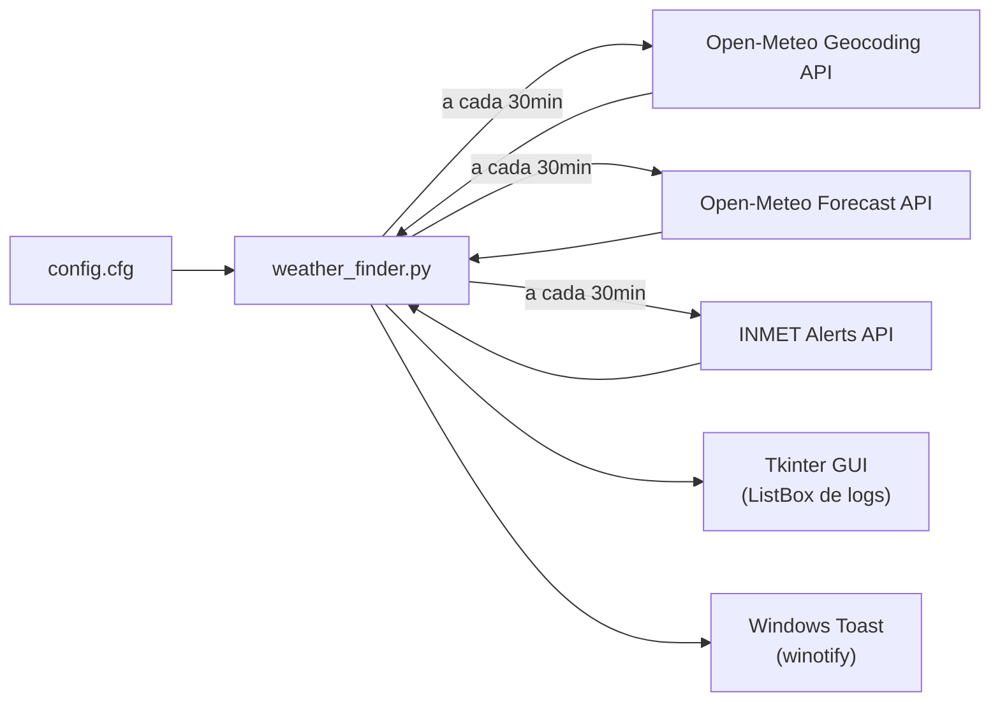

# Weather Finder — Ferramenta de Monitoramento Climático

Aplicação desktop Python para Windows 11 que consulta condições climáticas de cidades brasileiras a cada 30 minutos, exibindo logs em listbox decrescente e disparando notificações toast ("charm") do Windows a cada atualização e alerta meteorológico.

## Arquitetura Geral



## APIs Utilizadas (todas públicas, sem API key)

| API | Endpoint | Finalidade |
|-----|----------|------------|
| **Open-Meteo Geocoding** | `https://geocoding-api.open-meteo.com/v1/search?name={cidade}&country_code=BR&count=1` | Resolver nome da cidade → lat/lon |
| **Open-Meteo Forecast** | `https://api.open-meteo.com/v1/forecast?latitude={lat}&longitude={lon}&current=temperature_2m,relative_humidity_2m,wind_speed_10m,weather_code&hourly=temperature_2m,relative_humidity_2m,wind_speed_10m&forecast_hours=7&timezone=America/Sao_Paulo` | Dados climáticos atuais e previsão horária (6h) |
| **INMET Avisos Ativos** | `https://apiprevmet3.inmet.gov.br/avisos/ativos` | Alertas meteorológicos oficiais para o Brasil |

## Proposed Changes

### Estrutura de arquivos

```
weather-finder/
├── weather_finder.py     # Aplicação principal (GUI + lógica)
├── weather_api.py        # Cliente Open-Meteo (geocoding + forecast)
├── alerts_api.py         # Cliente INMET (alertas ativos)
├── notifier.py           # Notificações toast do Windows 11
├── config.cfg            # Arquivo de configuração editável
├── icon.ico              # Ícone da aplicação
├── requirements.txt      # Dependências pip
├── run.bat               # Script de inicialização rápida
└── README.md             # Documentação de uso
```

---

### [NEW] [config.cfg](file:///c:/Users/neialuc/Documents/GitHub/weather-finder/config.cfg)

Arquivo de configuração editável pelo usuário. Formato INI com seção `[Localizacao]`:

```ini
[Localizacao]
# Informe o nome da cidade brasileira para consulta
cidade = São Paulo

[Preferencias]
# Intervalo de consulta em minutos (padrão: 30)
intervalo_minutos = 30
```

---

### [NEW] [weather_api.py](file:///c:/Users/neialuc/Documents/GitHub/weather-finder/weather_api.py)

Módulo responsável por:
- **`geocode_city(city_name)`** — Consulta a API de geocoding do Open-Meteo filtrando por `country_code=BR`. Retorna `(latitude, longitude, nome_resolvido)` ou levanta exceção se não encontrar.
- **`fetch_weather(lat, lon)`** — Consulta a API de forecast do Open-Meteo requisitando:
  - **Dados atuais**: `temperature_2m`, `relative_humidity_2m`, `wind_speed_10m`, `weather_code`
  - **Dados horários (próximas 6h)**: `temperature_2m`, `relative_humidity_2m`, `wind_speed_10m`
  - Retorna um dicionário estruturado com:
    - Temperatura atual, umidade, vento, código de condição
    - Para cada hora (próximas 6): temperatura, umidade, vento
    - Temperatura máxima e mínima nas próximas 6 horas
- **`weather_code_to_description(code)`** — Traduz os códigos WMO para descrições em português (ex: 0 → "Céu limpo", 61 → "Chuva leve", 95 → "Tempestade").

---

### [NEW] [alerts_api.py](file:///c:/Users/neialuc/Documents/GitHub/weather-finder/alerts_api.py)

Módulo responsável por:
- **`fetch_alerts(city_name, state_abbr=None)`** — Consulta `https://apiprevmet3.inmet.gov.br/avisos/ativos` e filtra os alertas que contenham a cidade informada no campo `municipios`. Retorna lista de alertas com:
  - Severidade e cor (Perigo Potencial / Perigo / Grande Perigo)
  - Descrição do tipo de evento (Baixa Umidade, Tempestade, etc.)
  - Riscos e instruções
  - Horário de início/fim
- Cache básico para evitar consultas repetidas desnecessárias à API do INMET dentro do mesmo ciclo.

---

### [NEW] [notifier.py](file:///c:/Users/neialuc/Documents/GitHub/weather-finder/notifier.py)

Módulo de notificações Windows 11 usando a biblioteca **`winotify`**:
- **`notify_weather_update(city, temperature, condition)`** — Dispara toast com ícone normal informando o resumo da nova consulta (título: "🌤 Weather Finder — {cidade}", corpo: temperatura + condição).
- **`notify_alert(city, severity, description, risks)`** — Dispara toast com ícone de aviso (⚠️) para alertas meteorológicos. Usa `urgency` elevada para garantir destaque no Action Center. Diferencia visualmente por severidade (Perigo Potencial = amarelo, Perigo = laranja, Grande Perigo = vermelho).

---

### [NEW] [weather_finder.py](file:///c:/Users/neialuc/Documents/GitHub/weather-finder/weather_finder.py)

Aplicação principal com interface Tkinter. Componentes:

#### GUI
- **Janela principal** com título "Weather Finder"
- **Label superior** mostrando a cidade configurada e status da última consulta
- **Frame de alertas** (visível apenas quando há alertas ativos) — fundo vermelho/amarelo com detalhes do alerta
- **Listbox** (com scrollbar) em ordem decrescente (novos no topo) mostrando logs formatados:
  ```
  ═══════════════════════════════════════════════
  📅 02/09/2026 15:30 — São Paulo, SP
  ───────────────────────────────────────────────
  🌡 Temperatura atual: 24.5°C | Condição: Parcialmente nublado
  💨 Vento: 12.3 km/h | 💧 Umidade: 65%
  
  ⏰ Previsão próximas 6 horas:
    16h → 25.1°C | 💨 11.0 km/h | 💧 62%
    17h → 24.8°C | 💨 10.5 km/h | 💧 64%
    18h → 23.2°C | 💨  9.8 km/h | 💧 68%
    19h → 22.0°C | 💨  8.5 km/h | 💧 72%
    20h → 21.3°C | 💨  7.2 km/h | 💧 75%
    21h → 20.8°C | 💨  6.8 km/h | 💧 78%
  
  🔺 Máxima 6h: 25.1°C | 🔻 Mínima 6h: 20.8°C
  ═══════════════════════════════════════════════
  ```
- **Botão "Consultar Agora"** para forçar consulta imediata
- **Botão "Encerrar"** para o usuário fechar a aplicação de forma segura (cancela timers pendentes, encerra threads de background e fecha a janela)
- **Barra de status** inferior com próxima consulta agendada

#### Lógica de background
- Usa `threading.Timer` recorrente para disparar consulta a cada N minutos (padrão 30)
- Cada ciclo:
  1. Lê `config.cfg` (permite trocar cidade em tempo real)
  2. Resolve geocoding (com cache)
  3. Busca dados climáticos
  4. Busca alertas INMET
  5. Formata log e insere no topo do Listbox
  6. Dispara toast "charm" com resumo
  7. Se há alertas, exibe no frame de alertas e dispara toast de alerta com ⚠️
- Thread-safe: usa `root.after()` para atualizar GUI a partir da thread de background

---

### [NEW] [icon.ico](file:///c:/Users/neialuc/Documents/GitHub/weather-finder/icon.ico)

Ícone simples da aplicação (gerado programaticamente via Pillow se necessário, ou embutido).

---

### [NEW] [requirements.txt](file:///c:/Users/neialuc/Documents/GitHub/weather-finder/requirements.txt)

```
requests>=2.31.0
winotify>=1.1.0
Pillow>=10.0.0
```

- `requests` — Cliente HTTP para chamadas de API
- `winotify` — Notificações toast nativas do Windows 11
- `Pillow` — Geração de ícone da aplicação

---

### [NEW] [run.bat](file:///c:/Users/neialuc/Documents/GitHub/weather-finder/run.bat)

Script batch para inicialização rápida:
```bat
@echo off
echo Iniciando Weather Finder...
python weather_finder.py
```

---

### [NEW] [README.md](file:///c:/Users/neialuc/Documents/GitHub/weather-finder/README.md)

Documentação em português incluindo:
- Descrição do projeto
- Pré-requisitos (Python 3.10+)
- Instalação (`pip install -r requirements.txt`)
- Configuração (editar `config.cfg`)
- Uso (`python weather_finder.py` ou `run.bat`)
- Screenshots do funcionamento

## User Review Required

> [!IMPORTANT]
> **Biblioteca de notificação**: Proponho usar `winotify` por ser leve e estável no Windows 11. A alternativa `win11toast` oferece mais recursos (botões, progress bar) mas é mais pesada. Deseja alguma preferência?

> [!IMPORTANT]
> **Interface Tkinter**: Optei por Tkinter por ser nativo do Python (sem instalação extra). Se preferir uma interface mais moderna, posso usar `customtkinter` ou `PyQt5`, mas isso adiciona dependências.

## Verification Plan

### Automated Tests
- Validação de parsing de `config.cfg` com cidades de teste
- Teste unitário de `weather_code_to_description()` com todos os códigos WMO
- Teste de conexão com as APIs (smoke test)

### Manual Verification
- Executar a aplicação com `python weather_finder.py`
- Verificar que a consulta inicial ocorre ao abrir
- Verificar toast notification no Action Center do Windows 11
- Alterar cidade no `config.cfg` e verificar que a próxima consulta usa a nova cidade
- Simular alerta: verificar formatação e toast de alerta
- Validar que o Listbox mostra logs em ordem decrescente
